<div align="center">

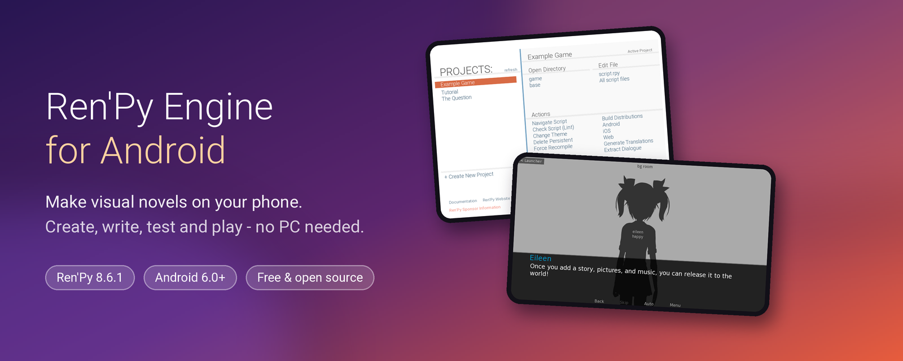

# Ren'Py Engine for Android

**The full Ren'Py 8.6.1 SDK, on your phone. Create, write, test and play
visual novels without a PC.**

[](https://github.com/eren-coder07/RenPy-Android-Port/releases/latest)

[](https://github.com/eren-coder07/RenPy-Android-Port/actions/workflows/android-release.yml)


[Download](#-install) · [Screenshots](#-screenshots) · [Getting started](#-getting-started) · [FAQ](#-faq--troubleshooting) · [How it works](#-how-it-works)

</div>

> [!NOTE]
> This is an **unofficial community port**. It is not made or endorsed by the
> Ren'Py project. Ren'Py itself is by Tom Rothamel and contributors
> ([renpy.org](https://www.renpy.org)).

---

## ✨ Features

|   |   |
|---|---|
| 🚀 **Real Ren'Py launcher** | The same launcher as on PC: projects list, actions and preferences, in 20+ languages. |
| 🆕 **Create New Project** | The full GUI template: resolution, colour theme, generated images and translations, all made on the phone. |
| ▶️ **Launch Project** | Runs your game inside the app. Tap **‹ Launcher** in the corner to come back. |
| 🔍 **Navigate Script** | Jump to any label, define, screen or transform in your project. |
| ✅ **Check Script (Lint)** | Full lint report, shown in the app. |
| 📝 **File viewer + your editor** | Read any script in the app, then **Open in editor app** (Acode, QuickEdit, Markor, …) to edit it. |
| 🎨 **Change/Update GUI**, 🌍 **Generate Translations**, 💬 **Extract Dialogue**, ♻️ **Force Recompile**, 🧹 **Delete Persistent** | All of them run on the phone. |
| 🛡️ **Errors don't close the app** | A broken script shows Ren'Py's error screen. Fix it in your editor and tap **Reload**, or **Quit** back to the launcher, which shows the full traceback. |
| 📚 **Tutorial & The Question** | Both bundled, so you can learn Ren'Py right on the device. |
| 📂 **Your files, your folder** | Projects are plain files in `RenPyProjects` on your phone storage. Copy them to a PC at any time. |

---

## 📸 Screenshots

<table>
  <tr>
    <td width="33%">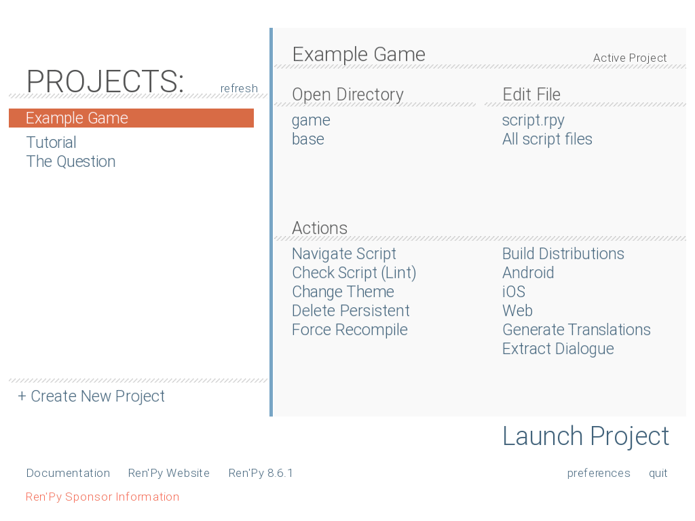<br><sub><b>The launcher</b>: your projects and every action.</sub></td>
    <td width="33%">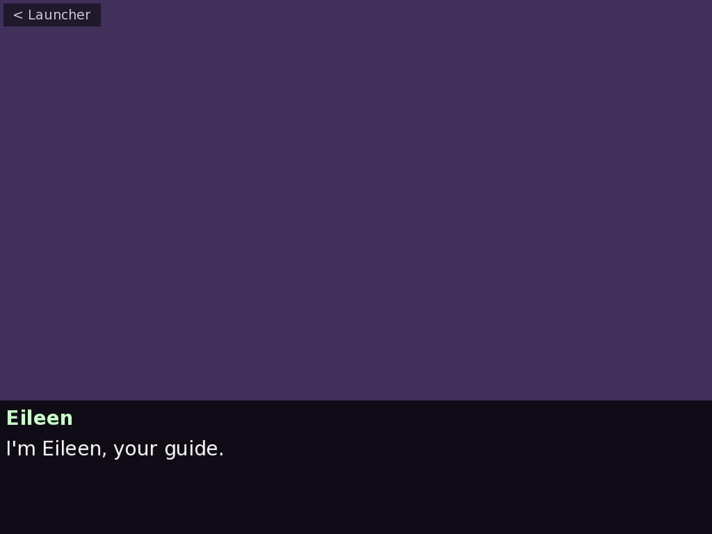<br><sub><b>Launch Project</b>: the game runs in the app.</sub></td>
    <td width="33%">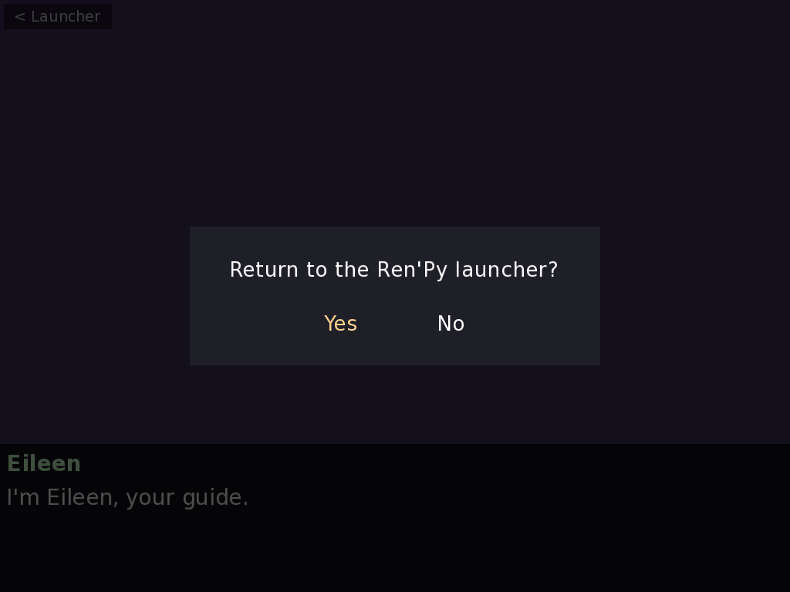<br><sub><b>‹ Launcher</b> takes you back at any time.</sub></td>
  </tr>
  <tr>
    <td>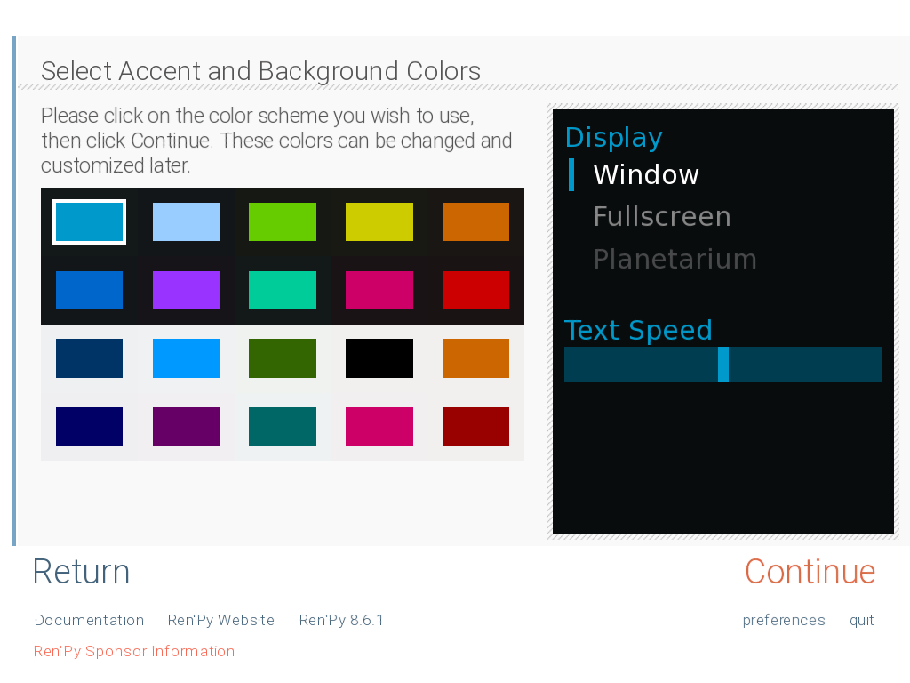<br><sub><b>New Project</b>: pick a colour scheme…</sub></td>
    <td>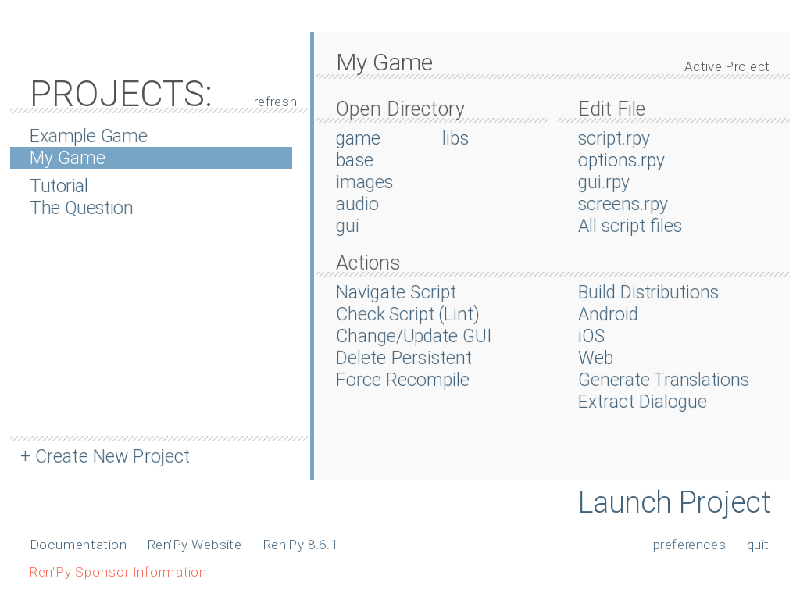<br><sub>…and get the full GUI template.</sub></td>
    <td>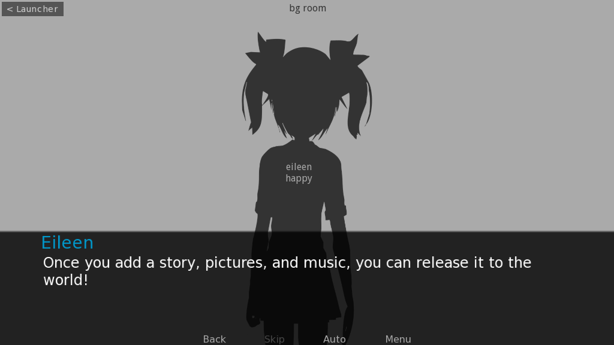<br><sub>Your new game, playable right away.</sub></td>
  </tr>
  <tr>
    <td>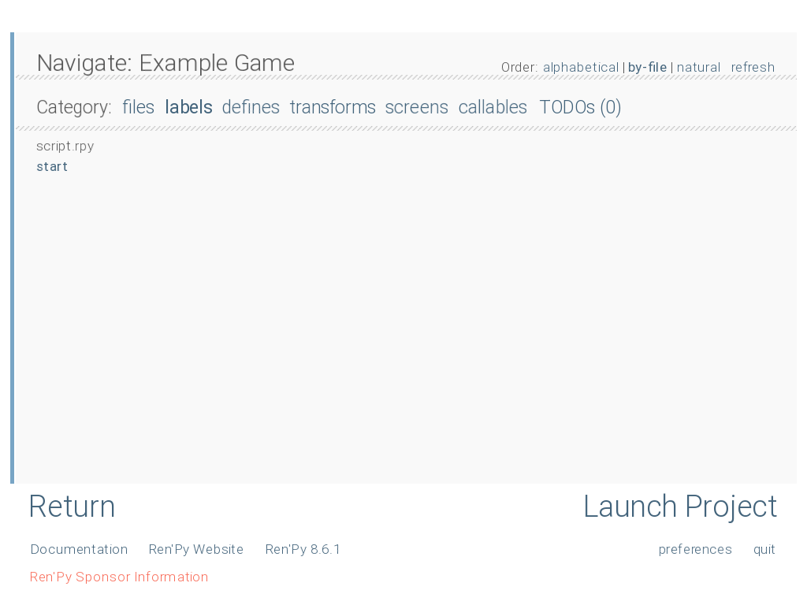<br><sub><b>Navigate Script</b>: labels, defines, screens.</sub></td>
    <td>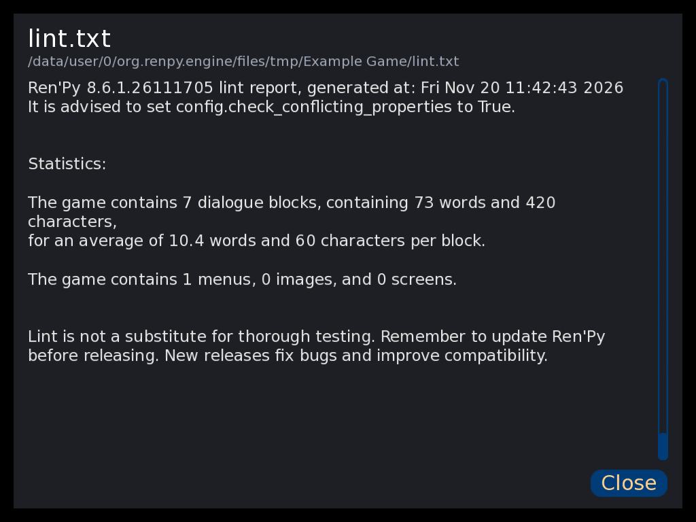<br><sub><b>Check Script</b>: the lint report.</sub></td>
    <td>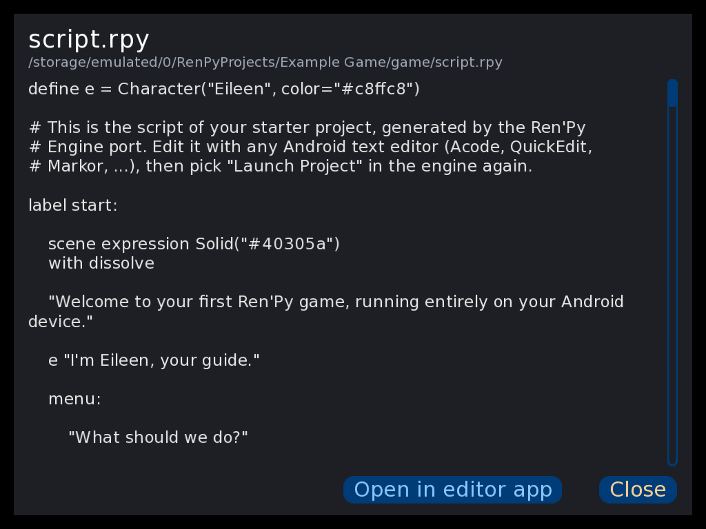<br><sub><b>File viewer</b> with <i>Open in editor app</i>.</sub></td>
  </tr>
  <tr>
    <td>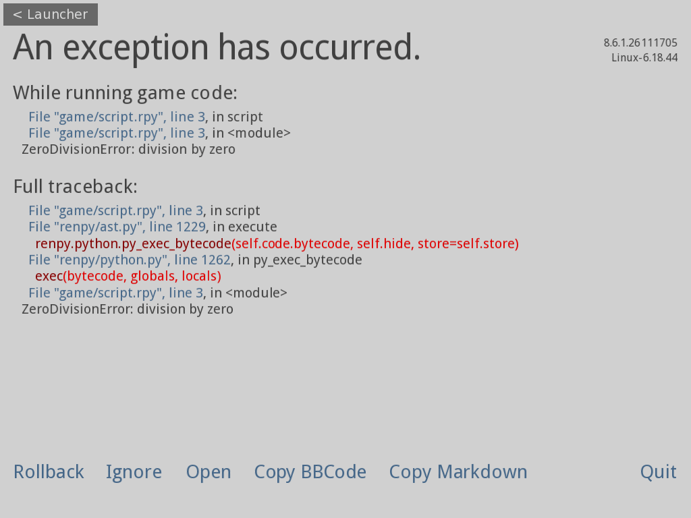<br><sub>A bug in your script shows Ren'Py's error screen…</sub></td>
    <td>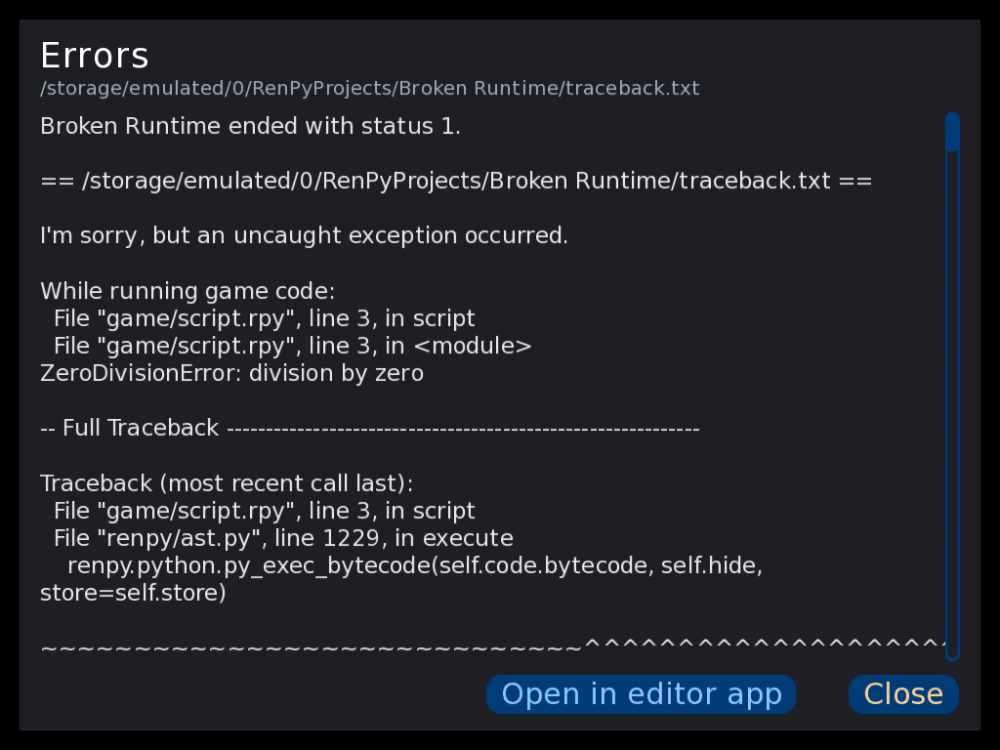<br><sub>…and <b>Quit</b> brings the traceback to the launcher.</sub></td>
    <td>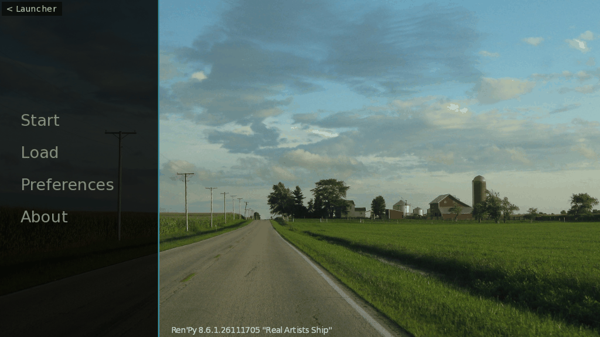<br><sub>The official <b>Tutorial</b>, bundled.</sub></td>
  </tr>
</table>

<sub>Screenshots are from the release build, running in the project's Android simulator (see [Testing](#-testing-without-a-phone)).</sub>

---

## 📲 Install

| Requirement | |
|---|---|
| Android | **6.0 or newer** |
| Graphics | **OpenGL ES 3.0** (nearly every phone from the last ten years) |
| CPU | arm64 (most phones), arm32 (older phones) or x86_64 (emulators), all in one APK |
| Space | a 105 MB download; the engine unpacks itself on first start, so leave a few hundred MB free for it and your projects |

1. Download **`RenPy-8.6.1-engine-android-universal-arm32-arm64.apk`** from the
   [latest release](https://github.com/eren-coder07/RenPy-Android-Port/releases/latest).
2. Open it. If Android asks, allow your browser or file manager to
   **install unknown apps**.
3. Start **Ren'Py Engine** and pick your language.
4. Tap **Grant file access** (top right) and allow it:
   - **Android 11 and newer:** turn on *Allow access to manage all files*, then go back.
   - **Android 6 – 10:** tap *Allow* in the dialog.

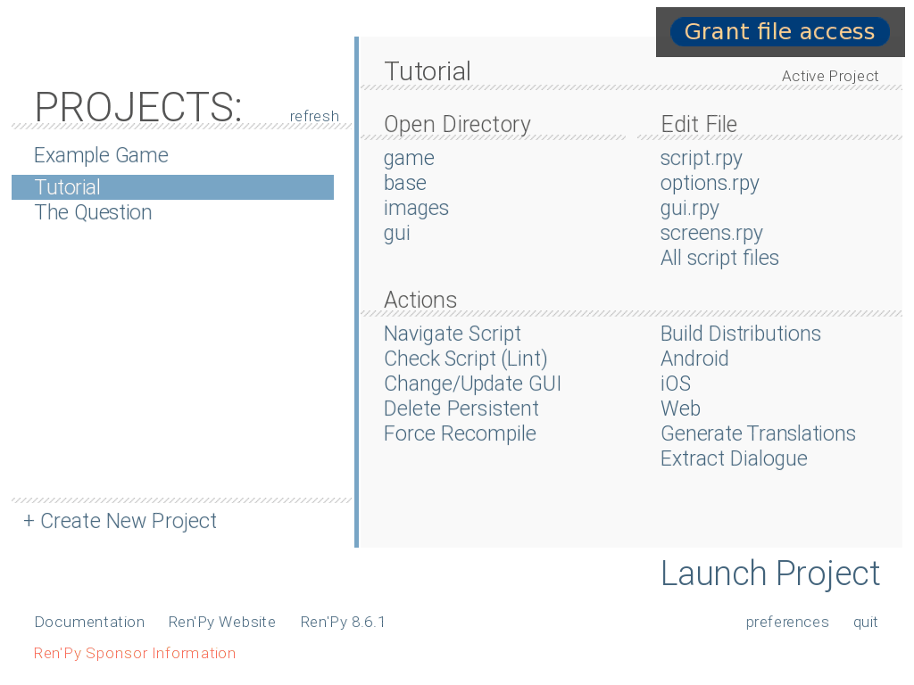

> [!TIP]
> You can skip step 4. Your projects are then kept in the app's own folder,
> and the launcher moves to `RenPyProjects` once you grant access, unless
> you've already made projects in the app's folder.

**Updating:** install the new APK over the old one. Your projects and
settings stay.

---

## 🚀 Getting started

### Your first five minutes

1. Select **Example Game** in the projects list. The app creates it on first start.
2. Tap **Launch Project** and play it. Tap **‹ Launcher** (top left) → **Yes** to come back.
3. Under **Edit File**, tap **script.rpy**. It opens in the viewer.
4. Tap **Open in editor app**, pick your editor, change a line of dialogue and save.
5. Back in Ren'Py Engine, tap **Launch Project** again to see your change.

### Making your own game

1. Tap **+ Create New Project**, name it, and pick a resolution and colour scheme.
   The launcher builds the full GUI template, like on PC.
2. Edit `game/script.rpy` (story), `game/options.rpy` (settings) and
   `game/gui.rpy` / `game/screens.rpy` (look). Use **Open in editor app** or
   open them straight from your editor.
3. Put images in `game/images/` and music in `game/audio/`.
4. Tap **Check Script (Lint)** now and then to catch mistakes early.
5. Tap **Launch Project** to test.

### Recommended editor apps

Any app that edits plain text works. These are good for Ren'Py:

- **Acode** has syntax highlighting, tabs and a file tree. Open the
  `RenPyProjects` folder as a project.
- **QuickEdit** is fast, with line numbers.
- **Markor** is simple and dependable.

> [!TIP]
> Ren'Py scripts are **indentation-sensitive**. Set your editor to insert
> **4 spaces** for Tab.

### Where are my files?

| What | Where |
|---|---|
| Your projects | `/storage/emulated/0/RenPyProjects/<project>/` |
| Projects (no file access granted) | `/storage/emulated/0/Android/data/org.renpy.engine/files/RenPyProjects/` |
| A project's saves | `<project>/game/saves/` |
| A project's errors | `<project>/traceback.txt`, `<project>/errors.txt` |
| Crash report (if the app closes) | `RenPyProjects/renpy_crash.txt` |

---

## ✅ What works / ❌ What needs a PC

| Works on the phone | Needs the desktop Ren'Py SDK |
|---|---|
| ✅ Create New Project (GUI template) | ❌ **Build Distributions** (Windows / Mac / Linux zips) |
| ✅ Launch Project, Tutorial, The Question | ❌ **Android** (build an APK of your game) |
| ✅ Navigate Script, Check Script (Lint) | ❌ **iOS** (needs Xcode) |
| ✅ Change/Update GUI | ❌ **Web** (needs the web toolchain) |
| ✅ Generate Translations, Extract Dialogue | |
| ✅ Force Recompile, Delete Persistent | |
| ✅ Edit files (viewer + your editor app) | |

When your game is ready to ship, copy its project folder to a PC with the
[Ren'Py SDK](https://www.renpy.org/latest.html) and build from there. The
project is the same on both.

---

## ❓ FAQ & troubleshooting

<details>
<summary><b>How do I get back to the launcher from a game?</b></summary>

Tap the small **‹ Launcher** button in the top-left corner, then **Yes**.
It's on every screen, including the game's menus. Ren'Py hides the *Quit*
button on phones, which is why this button exists.
</details>

<details>
<summary><b>I changed my script, but the game didn't change.</b></summary>

Save the file in your editor, then go back and tap **Launch Project** again.
If you're on an error screen, tap **Reload**. If it still looks old, tap
**Force Recompile**.
</details>

<details>
<summary><b>My game shows "An exception has occurred" or a parse error.</b></summary>

That's Ren'Py telling you where the problem is: file name and line number.
Tap **Open** to view the full report, fix the line in your editor, then tap
**Reload** (parse errors) or **Quit** → **Launch Project**. After **Quit**,
the launcher also shows the traceback.
</details>

<details>
<summary><b>"Open in editor app" says no app could open the file.</b></summary>

Install a text editor (see the recommended apps above), or open the file from
inside the editor: browse to `RenPyProjects/<project>/game/`.
</details>

<details>
<summary><b>I don't see my projects / the folder is empty.</b></summary>

Tap **Grant file access** if it's showing, then **refresh** next to
*PROJECTS:*. Projects made before you granted access are in
`Android/data/org.renpy.engine/files/RenPyProjects/`. Move them to
`/storage/emulated/0/RenPyProjects/` with a file manager.
</details>

<details>
<summary><b>The app closed by itself.</b></summary>

It shouldn't. If it does, open `RenPyProjects/renpy_crash.txt` (or
`Android/data/org.renpy.engine/files/renpy_crash.txt`) and attach it to a
[new issue](https://github.com/eren-coder07/RenPy-Android-Port/issues/new),
along with your phone model and Android version.
</details>

<details>
<summary><b>Can I publish a game made with this?</b></summary>

Yes. Your project is a normal Ren'Py 8.6.1 project. Build the release with
the desktop SDK (see above). Ren'Py's [license](https://www.renpy.org/doc/html/license.html)
applies to games, the same as on PC.
</details>

<details>
<summary><b>Does it need the internet?</b></summary>

No. Everything runs offline. The *Documentation* and *Ren'Py Website* links
open your browser.
</details>

### Reporting a bug

Please [open an issue](https://github.com/eren-coder07/RenPy-Android-Port/issues/new) with:

- your phone model and Android version
- what you tapped, step by step
- `renpy_crash.txt` if the app closed, or `traceback.txt` / `errors.txt` /
  `log.txt` from the project folder.

---

## 🛠 How it works

<details>
<summary><b>The short version</b></summary>

On a PC, the launcher starts **a second Ren'Py process** for every game run
and every tool (lint, scans, translations…). Android can't do that, so this
port runs them **in the same process** and switches between the launcher and
your project:

1. The launcher turns each action into a *job*: the exact
   `renpy.sh <project> <command>` line the PC would run.
2. The engine restarts itself in-process, runs the job, and returns to the
   launcher however the job ends. That covers finishing, quitting, a parse
   error, an uncaught exception or `sys.exit()`. The graphics renderer is kept
   across the switch.
3. Launcher steps that wait for a tool's result (Navigate Script, lint,
   Change GUI, translations) resume as if the tool had run in the background.

Jobs live in memory only, so starting the app always opens the launcher. A
broken project can never trap you in a crash loop.
</details>

<details>
<summary><b>The long version (for contributors)</b></summary>

| Piece | What it does |
| --- | --- |
| `port/build_android.py` | Downloads the official Ren'Py SDK + RAPT, patches them, compiles the launcher, assembles the `android.dist` tree and drives `rapt.build.build()` directly. `--stage-only` skips Gradle. |
| `port/patches/main.py` | Replaces `renpy.py` as the bootstrap: job queue, in-process hand-off, the "‹ Launcher" button, crash dumps. |
| `port/patches/mobile_support.rpy` | Launcher additions: projects folder (with or without storage permission), starter project, on-device `Project.launch`, flow resumption, file viewer, "Grant file access". |
| `renpy/bootstrap.py` patch | Starts jobs, returns to the launcher however a run ends, keeps the renderer, writes fatal errors before Android's `System.exit`. |
| `renpy/editor.py` patch | The system editor hands files to the launcher's viewer. |
| `renpy/lint.py`, `renpy/translation/*` patches | Ren'Py's common files come from the APK, with no common directory on disk. |
| `renpy/loader.py` patch | In project mode the packaged launcher assets are skipped. |
| `gui7/code.py` patch + `launcher/` on disk | New Project reads the icon template and translated template code from disk. |
| `app-AndroidManifest.xml` patch | `requestLegacyExternalStorage` for Android 10. |
| `iconmaker.py` patch | Runs without pygame_sdl2 and finds icons in the dist directory. |
</details>

---

## 🧪 Testing without a phone

`port/sim/` runs the packaged engine on Linux **as if it were Android**. It
uses the real RAPT packaging (private tar + APK assets), the real `android`
runtime package, and the Android code paths of the engine and the port; only
pyjnius is stubbed. It renders offscreen with Mesa, taps buttons by their
text, and takes screenshots.

```bash
sudo apt-get install libegl1 libgles2 libegl-mesa0      # Mesa EGL/GLES
export BUILD_WORK=$PWD/build-work
sh port/sim/build_and_package.sh                        # stage + fake device
python3 port/sim/run_scenarios.py                       # all UI scenarios
```

The scenarios in `port/sim/scenarios/` cover launch and return, every
launcher tool, New Project, game errors, missing storage permission and the
desktop-only buttons. **CI runs them before every release**, so a build that
crashes in the simulator is never published. Screenshots are uploaded as a
build artifact.

## 🏗 Building from source

```bash
pip install pillow
python3 port/build_android.py      # needs JDK 21, Android SDK, ~4 GB disk
```

The APK lands in `out/RenPy-8.6.1-engine-android-universal-arm32-arm64.apk`.
Release builds are signed by GitHub Actions with the keystore in the repo
secrets (`ANDROID_KEYSTORE_B64`, `RENPY_RELEASE_STORE_PASSWORD`,
`RENPY_RELEASE_KEY_ALIAS`). Every push to `main` that touches `port/`
publishes a new release.

---

## 📜 License & credits

- **Ren'Py** is copyright © Tom Rothamel and contributors, MIT licensed:
  [renpy.org](https://www.renpy.org). This port ships unmodified Ren'Py
  engine and launcher code plus the patches described above, which are
  also MIT.
- The bundled **Tutorial** and **The Question** are part of the Ren'Py SDK.
- Ren'Py's own license (in the SDK) covers the engine and its components.

<div align="center">
<sub>Made for everyone who has a story to tell and a phone in their pocket. 💜</sub>
</div>
